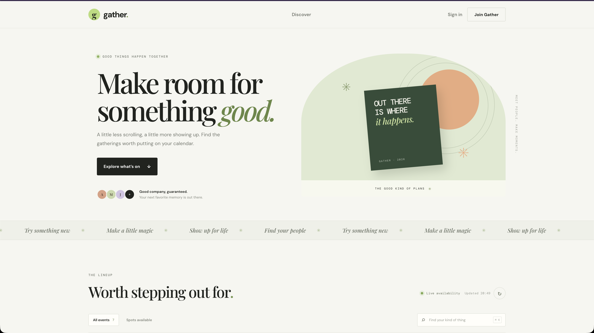
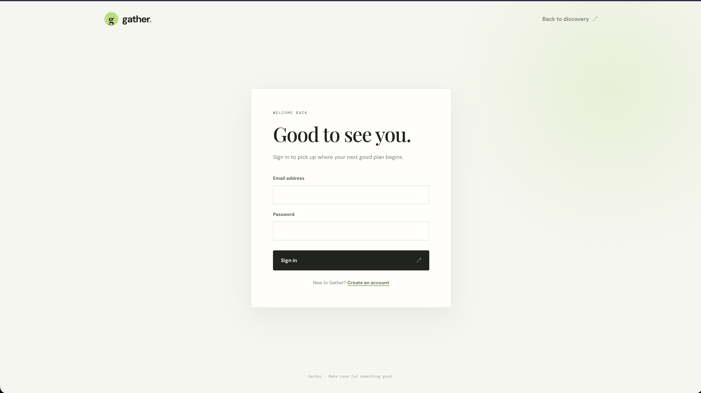
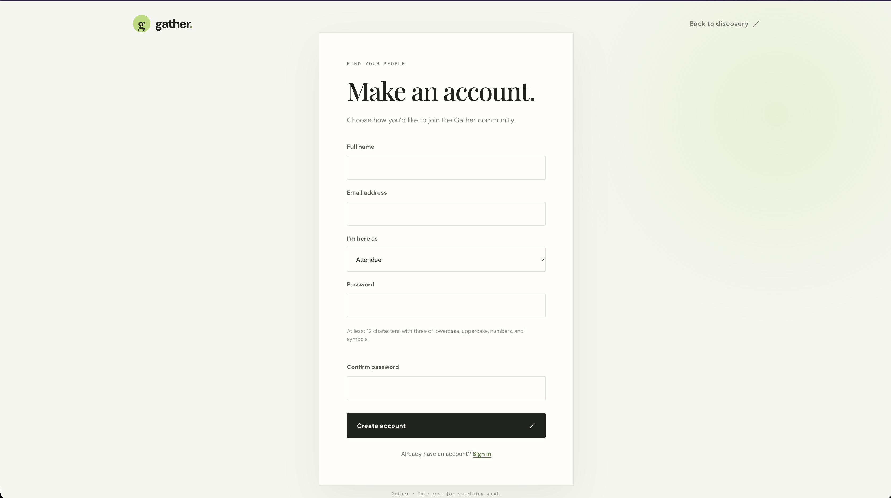
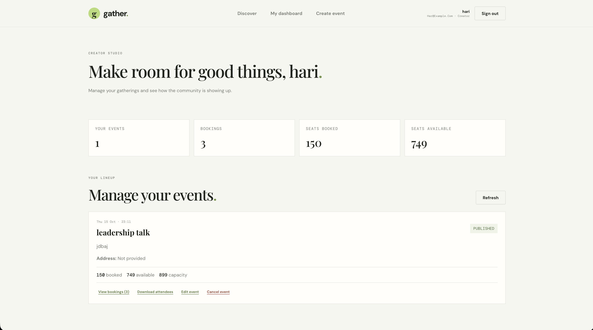
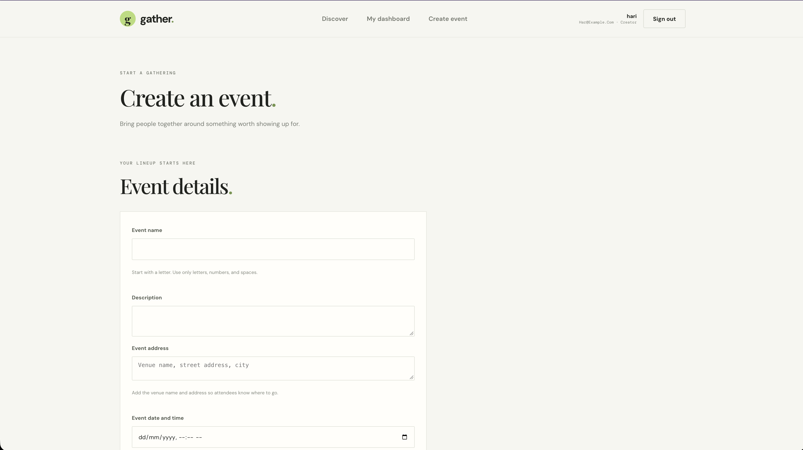
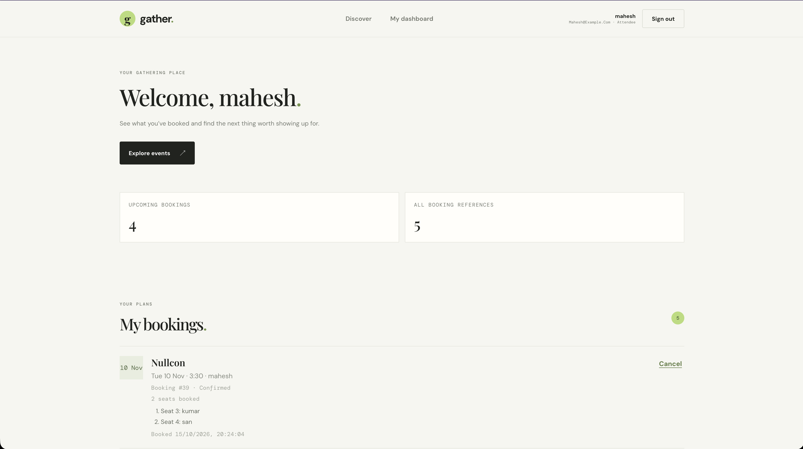

# Event Booking System

A full-stack event booking application with a FastAPI backend, React frontend,
SQLite database, and generated Python SDK. Attendees can discover events, book
multiple seats with confirmation, view their bookings, and cancel some or all
of their seats. Creators can manage events and view attendee bookings.

## Project preview

<table>
  <tr>
    <td align="center"><strong>Event discovery</strong><br></td>
    <td align="center"><strong>Sign in</strong><br></td>
  </tr>
  <tr>
    <td align="center"><strong>Create an account</strong><br></td>
    <td align="center"><strong>Creator dashboard</strong><br></td>
  </tr>
  <tr>
    <td align="center"><strong>Create an event</strong><br></td>
    <td align="center"><strong>Attendee dashboard</strong><br></td>
  </tr>
</table>

## Features

- Public event discovery, search, event details, and live seat availability.
- Attendee and creator registration with role-based access.
- Creator event creation and management, including an optional venue address
  that attendees can see on event cards and detail pages.
- Multi-seat bookings with an editable attendee name assigned to each seat and
  an explicit review and confirmation step. Each seat gets its own number, and
  the same seat cannot be assigned to multiple bookings.
- Attendees can book for other people, while the same account can include itself
  only once per event.
- Full or partial booking cancellation by selecting named seats; only cancelled
  seats return to event availability.
- Creator booking view with one row per attendee seat and an Excel export that
  lists seats individually.
- OpenAPI documentation and a Python SDK generated from the API schema.

## Requirements

- Python 3.9 or newer for the backend.
- Node.js and npm for the frontend.
- OpenSSL to generate a local development signing key.
- Python 3.10 or newer only if installing or running the generated SDK.

## Quick start

Run the backend and frontend in separate terminals. Commands below are for
macOS/Linux; for Windows, see the [Windows setup guide](./docs/windows-development-setup.md).

### 1. Get the project

```bash
git clone https://github.com/sv-sanjaiykumar/event_booking_system.git
cd event_booking_system
```

### 2. Set up and start the backend

```bash
cd backend
python3 -m venv .venv
source .venv/bin/activate
python -m pip install --upgrade pip
python -m pip install -e ".[test]"
cp -n .env.example .env
```

Generate a private key for local development:

```bash
openssl rand -hex 32
```

Copy the generated value into `backend/.env` as `JWT_SECRET_KEY`. Keep this
file private and do not commit it. The default `DATABASE_URL` uses SQLite and
creates the local database file in `backend/` when migrations run.

Apply migrations and start the API:

```bash
alembic upgrade head
uvicorn app.main:app --reload
```

The API is available at <http://127.0.0.1:8000>. Interactive API
documentation is at <http://127.0.0.1:8000/docs>.

### 3. Set up and start the frontend

In a second terminal, from the project root:

```bash
cd frontend
npm install
cp -n .env.example .env
npm run dev
```

Open <http://127.0.0.1:5173>. The frontend's default API URL is
`http://127.0.0.1:8000`. If the API runs elsewhere, set
`VITE_API_BASE_URL` in `frontend/.env` to the API origin (not the `/docs` URL).
Ensure the backend `CORS_ORIGINS` setting includes the frontend origin.

## Create and manage events

Register an account with the **Creator** role, sign in, and open the creator
dashboard. Choose **Create event** and enter the event name, description,
date/time, seat capacity, and (optionally) the venue name and full address.
After publishing, the event appears in public discovery. Attendees can view its
address on the event card and event detail page before booking.

Creators can edit their own events from the dashboard, including updating or
clearing the address. The dashboard also provides a per-seat booking list and
an Excel download with one attendee and seat number per row.

Attendees register with the **Attendee** role. During booking, they can enter a
name for each seat and choose whether one seat is for themselves. An attendee
can book seats for other people at the same event, but cannot include their own
account in more than one booking for that event. From **My bookings**, they can
cancel selected seats; released seats become available again.

The API also supports creator event management at `/events/` and
`/creator/events`, event details at `/events/{event_id}`, and creator-only
attendee bookings at `/creator/events/{event_id}/bookings`. See the interactive
API docs at <http://127.0.0.1:8000/docs> while the backend is running for the
complete endpoint list and request fields.

## Run tests

Backend tests (with the backend virtual environment activated):

```bash
cd backend
python -m pytest
```

Frontend tests and production build:

```bash
cd frontend
npm test
npm run build
```

## Python SDK

The generated SDK is in [`sdk/`](./sdk/). It requires Python 3.10 or newer.
See the [SDK usage guide](./sdk/SDK_USAGE.md) for installation, authentication,
booking, and cancellation examples. To regenerate it, start the backend and
follow the [SDK generation instructions](./sdk/README.md).

## Project documentation

- [Project structure and component responsibilities](./docs/project-structure.md)
- [Backend setup, migrations, and API endpoints](./backend/README.md)
- [Frontend setup and features](./frontend/README.md)
- [Python SDK usage](./sdk/SDK_USAGE.md)
- [Windows setup and startup](./docs/windows-development-setup.md)

## Security notes

Use a unique, strong `JWT_SECRET_KEY` for each environment and configure
production secrets outside the repository. Never commit `.env` files,
credentials, or access tokens. Use HTTPS when deploying the application.
